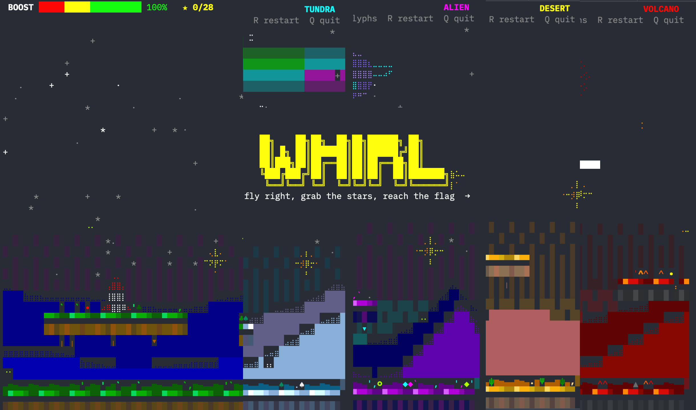

Run: `python3 whirl.py [--biome=tundra] [--blocks]` (or `python3 -m whirl`).
Needs a UTF-8 terminal, 256 colours, 60x24 or bigger.

Note: Largely AI-generated; I directed the design and play-tested it, but haven't audited every line.


## Layout

```
whirl.py                  launcher
whirl/
  app.py                   terminal setup, CLI args, main loop
  config.py                every tunable constant (physics, boost, level gen)
  colors.py                colour ids, lazy colour pairs, cp()
  input.py                 key BINDINGS + @action handlers
  game.py                  Game state, update order, default event handlers
  systems.py               gameplay rules (ground contact, stars, goal, confetti...)
  events.py                EventBus: star / crash / win / biome_enter
  rocket.py                Rocket entity: controls + flight integration
  physics.py               collisions + world bounds
  level.py                 procedural level: platforms, stars, goal, zones, decor
  camera.py  particles.py  effects.py (ambient biome particles)
  biomes/                  one file per biome (+ base.py dataclass & registry)
  gfx/                     Canvas (braille/blocks), sky bodies, mountain shapes, sprites
  render/                  Frame ctx, layer functions, HUD widgets/banners, Renderer
```

Dependency direction: `app -> game -> (level, rocket, physics, systems, particles, camera)`;
`render` only *reads* the game; `gfx` knows nothing about the game.

## Adding things

| I want to add...            | Do this |
|-----------------------------|---------|
| a **biome**                 | copy `biomes/meadow.py`, edit, add it to the import line in `biomes/__init__.py` |
| a **mountain profile**      | `@shape("name")` in `gfx/mountain_shapes.py`, then `shape="name"` on a biome |
| a **sky body / overlay**    | `@body("name")` / `@overlay("name")` in `gfx/sky.py`, then `sky="name"` |
| an **ambient effect**       | subclass `Ambient` with `@effect("name")` in `effects.py`, then `fx="name"` |
| a **particle kind**         | add an entry to `KINDS` in `particles.py`, spawn with `particles.add("kind", ...)` |
| a **gameplay mechanic**     | write a `System` in `systems.py`, append to `Game.flying_systems` (or `systems`) |
| a **reaction** (sound-ish juice, score) | `game.events.on("star", fn)` (see `install_default_handlers`) |
| a **HUD gauge / banner**    | `@widget` / `@banner` in `render/hud.py` |
| a **render layer**          | write `fn(frame)`, then `renderer.add_layer("name", fn, before="blit")` |
| a **key**                   | `bind("action", key)` + `@action("action")` in `input.py` |
| per-biome numbers           | put them in `Biome.props`, e.g. `props={"heat": 2.0}` |

### Example: a heat mechanic

```python
# systems.py
class Heat(System):
    def update(self, game):
        r = game.rocket
        r.heat = getattr(r, "heat", 0.0)
        rate = game.biome.props.get("heat", 0.0)
        r.heat += (rate * (1 if r.thrusting else -0.5)) * DT
        r.heat = max(0.0, min(100.0, r.heat))
        if r.heat >= 100.0:
            game.crash()

# game.py  ->  self.flying_systems.append(Heat())
# render/hud.py  ->  @widget def heat_bar(f): ...draw f.game.rocket.heat...
# biomes/volcano.py  ->  Biome(..., props={"heat": 12.0})
```
